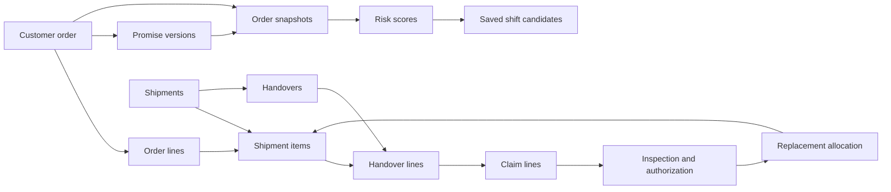

# Swedish Delivery Risk Pilot Database Knowledge

This document describes the business rules and current SQLite walkthrough for a delivery delay Agent. It is intended for engineers implementing ingestion, scoring, planner recommendations, redelivery handoffs, and evaluation. The working demo is defined by [schema.sql](schema.sql), populated by [seed.sql](seed.sql), and created with [run_demo.py](run_demo.py). The SQL files are the authority for columns and constraints that exist today. Sections marked **Planned** describe agreed behavior that the demo schema does not yet enforce.

## Purpose and scope

The Swedish pilot helps one regional planning team identify orders whose original planned deliveries may miss the customer promise. Warehouse staff enter packing and dispatch events, transport coordinators enter ETA changes, and staff at handover enter accepted, damaged, and missing quantities. A representative inspects a damage or shortage claim and may authorize reshipment. The assigned order management team handles that reshipment urgently.

Every example in the database is synthetic. The values in `risk_score` are illustrative inputs, not measured model accuracy. The pilot compares Logistic Regression and LightGBM only after suitable real outcome data exists.

## Shared vocabulary

| Term | Meaning |
|---|---|
| Order | One customer transaction for one commodity category, one destination, and one agreed delivery window. It can contain multiple products within that category. |
| Order line | One exact product and required quantity. Extra units of another product cannot cover a shortage. |
| Promise version | The delivery window agreed with the customer at a point in time. Preserve each revision. The window end is the delay cutoff. |
| Shipment | One physical movement. It can carry items for more than one order. An order can use multiple shipments. |
| Planned installment | An original shipment item allocated before delivery. Its remaining quantity is expected later under the original plan. |
| Handover | A recorded arrival at the delivery site, with item-level accepted, damaged, and missing quantities. Multiple handovers can refer to one shipment. |
| Claim | A reported discrepancy for one order that awaits or has received representative inspection. |
| Authorization | A representative's decision that specified disputed quantities require reshipment. |
| Reshipment | Replacement goods linked to an authorization, still belonging to the original customer order. It has its own tracking ID and customer-agreed replacement window. |
| Snapshot | Order and delivery evidence available at a specific scoring time, including the promise version. |
| Risk score | The model's `p_late` estimate for missing the original delivery promise. |
| High-risk override | A rule-driven state caused by authorized reshipment while approved replacement units remain unaccepted. |

## Relationships

`shipment_item` joins a physical shipment to an order line. Orders 1003 and 1004 share shipment `S34`, while order 1001 uses two different shipments. Replacement shipment `S35` carries two boards for order 1003 and is linked to authorization `A1003-1`.

## Tables implemented in the walkthrough

| Area | Tables | Current role |
|---|---|---|
| Catalog and orders | `commodity_category`, `product`, `customer_order`, `order_line`, `promise_version` | Products, quantities, and the agreed original window. |
| Transport and receipt | `shipment`, `shipment_item`, `shipment_eta_update`, `handover`, `handover_line` | Original and replacement movements, ETA changes, and item-level handover facts. |
| Claims and redelivery | `claim`, `claim_line`, `order_team`, `inspection`, `replacement_authorization`, `redelivery_task`, `replacement_allocation`, `replacement_promise` | Report, inspect, approve, assign, and track replacement. |
| Prediction and planning | `order_snapshot`, `risk_score`, `shift_list`, `shift_candidate` | Preserve two illustrative scores and one frozen shift entry. |

The demo uses a single product line in each order. The business definition permits multiple lines within one commodity category. The current schema has foreign keys for the basic relationships, but application logic must still enforce several cross-table quantity and ownership rules listed below.

## Time and visibility rules

Store timestamps in UTC using a consistent format, such as `2026-11-06T15:00:00Z`. Keep the delivery site's IANA time zone, such as `Europe/Stockholm`, with each customer promise. In the demo on 6 November 2026, the 16:00 Stockholm deadline is `15:00:00Z`. Acceptance at exactly the deadline counts as on time.

Distinguish **occurred at** from **recorded at**. A handover can happen at 10:00 and be entered at 10:20. A score calculated at 10:10 may use only records available by 10:10. The ETA example uses `recorded_at_utc` to decide whether an update was visible. Promise changes also need both effective and recorded times in a later schema revision. A snapshot must retain the exact promise version and feature values used for its score.

For a shared shipment serving several sites, arrival estimates belong to the relevant delivery stop or order. The current `shipment_eta_update` table is shipment-wide, which is sufficient for the four demo orders but needs refinement for a broader pilot.

## State transitions the Agent must respect

1. **Order import.** The retailer's order system supplies a stable source ID, destination, category, products, quantities, agreed window, and assigned order management team. The destination assigns the planning region. Repeated imports update the same source order while preserving promise revisions. **Planned.** The demo creates orders directly and lacks source-system, destination, and planning-region columns.
2. **Original delivery progress.** Original shipment allocations and staff events show what remains to be packed, dispatched, and accepted. A planned second installment is normal progress. Accepted quantities count toward the matching product line.
3. **Claim opening.** A damaged or missing quantity recorded at handover, or reported later, opens an inspection claim. The claim itself does not trigger the reshipment override.
4. **Representative decision.** Approval records the affected claim lines, quantities, representative, and decision time. In one transaction, it starts the override, stops future model scoring for the order, and creates an urgent task for its assigned order management team. A declined claim is retained without a replacement task. A repeated approval request must resolve to the same authorization and task.
5. **Replacement handling.** The team confirms a customer-agreed replacement window. Transport can revise the ETA for the replacement shipment. Each accepted replacement unit reduces the approved outstanding balance. Dispatching it does not reduce that balance.
6. **Override resolution.** The override is active while any approved replacement quantity is outstanding. It clears when every approved replacement quantity is accepted. Model scoring stays stopped for an order that has required reshipment. Other originally planned installments may still be outstanding.

The Agent can recommend that staff inspect, prioritize, contact a warehouse, or confirm a route. A representative authorizes reshipment. The Agent should record its recommendation and evidence before alerting staff.

## Risk and worklist rules

The proposed model estimates `p_late`, the probability that original planned delivery will miss the promise version attached to its snapshot. The overview proposes Low below 0.20, Medium from 0.20 through 0.50, and High above 0.50. High due to model output and High due to authorized reshipment need distinct reason codes and owners.

Score eligible open orders after meaningful source changes. These include order or promise updates, stock changes, warehouse milestones, shipment assignment, route or ETA changes, and relevant travel or weather changes. Scheduled rescoring covers open orders as their deadline approaches. Stop scoring on delivery, cancellation, or reshipment authorization. The exact timer policy is a deployment setting.

At shift start, the regional planner selects the latest available score for each eligible order, ranks distinct orders, and freezes the top K according to that team's review capacity. The candidate population and ranks must be retained to calculate Precision@K, Recall@K, and average precision. Later scores can change the live queue but cannot rewrite the saved shift view. Authorized redelivery tasks go directly to the order's assigned management team and use that team's capacity.

An alert episode should send one initial staff alert containing `p_late`, the promise, hours left, reasons, and recommended action. Follow-ups occur for material worsening, a changed recommendation, or an unacknowledged escalation deadline. Delivery, cancellation, or resolved risk closes the episode. **Planned.** The current schema has no episode, recommendation, playbook, alert, acknowledgment, or escalation tables.

## Outcomes and evaluation

| Outcome | Rule |
|---|---|
| Customer promise met | Every order line reaches its required acceptable quantity by the relevant customer promise end. Approved later claims can change the acceptable balance. Report against original and final agreed promises. |
| Original delivery on time | The last originally planned installment reaches its recorded completion milestone by the promise end. Exclude replacement movements. |
| Replacement promise met | All units covered by the agreed replacement window are accepted by its end. |
| Prediction label | Evaluate each pre-authorization score against original delivery completion and the promise version that score referenced. Retain pre-authorization scores even if a claim is later approved. Mark the label unknown when original completion cannot be independently established. |

For order 1003, original handover `H34` occurred Friday at 15:45 Stockholm time and was on time. Two damaged boards were rejected, then accepted on Monday after representative authorization. The full acceptable customer order missed Friday's original promise. Both replacements arrived by Monday's agreed 11:00 deadline. These are three separate results.

## Four synthetic orders

| Order | Scenario | Verified result |
|---|---|---|
| 1001 | 100 pine boards in planned installments of 60 and 40. | 100 accepted by Friday 15:30 Stockholm, on time. |
| 1002 | 20 oak boards, ETA revised from 15:00 to 17:00 at 09:00. | All accepted at 16:45, 45 minutes late. The revised ETA was 15 minutes later than actual arrival. |
| 1003 | 10 pine boards on `S34`, eight accepted and two damaged. Approval triggers two replacement boards on `S35`. | One claim and one urgent task. Override remains active after one replacement is accepted and clears after the second. Original handover on time, customer promise late, replacement promise met. |
| 1004 | 12 oak boards share `S34` with order 1003. | All accepted on time. No claim or redelivery task. |

Order 1002 has illustrative scores of 15% before the ETA update and 75% after it. The saved demo shift entry retains the 15% score visible at shift start, while the latest live score is 75%.

## Agent read and write contract

The Agent should read an order by its stable ID, fetch its current promise and original shipment allocations, then fetch events and ETA updates recorded by the decision time. It should gather claims and approved replacement balances separately. A risk response should include the score ID, snapshot ID, model version, evidence timestamps, reason codes, current owner, and relevant delivery deadline. The Agent must distinguish a missing source value from a confirmed value.

Actions should append events or create versioned records. They should not overwrite historical promises, ETAs, handovers, scores, or representative decisions. Use stable command or source event IDs for retries. Put approval, override state change, and task creation in one transaction. Put alert episode updates and outbound notification intent in one transaction, then deliver notifications through a retryable worker. **Planned.** The demo shows the data relationships and uses unique IDs, but it does not implement these services or transactional workflows.

## Current schema limits before building the full Agent

- `customer_order` lacks source-system identity, customer, delivery site, planning region, cancellation, and explicit owner for all orders. The demo's `order_team` has one row for order 1003.
- `shipment` lacks origin warehouse, carrier, route, vehicle, stops, and explicit original-versus-replacement type. Replacement type is inferred from `replacement_allocation`.
- `handover_line` lacks a database constraint preventing cumulative accepted or disputed quantities from exceeding an item's allocation. The claim and authorization tables likewise need quantity reconciliation checks.
- A later claim against units initially recorded as accepted needs a separate accepted-quantity adjustment event. The current customer-completion calculation handles the demo's damage recorded at handover.
- `order_snapshot` stores one ETA and promise end for the demo. A full scoring snapshot needs all source features, missingness, provenance, and an immutable model input record. No trained model is included.
- Risk episodes, recommendations, playbooks, alerts, and acknowledgment are design requirements that still need tables and application workflows.
- The shift demo freezes one order with K = 1. Region membership and full candidate ranking still need implementation.
- Cross-table invariants require application transactions or database triggers. Foreign keys alone do not enforce product category membership, exact order ownership of a replacement, approval quantity ceilings, or scoring eligibility.

## Run the walkthrough yourself

From the folder containing the three demo files, run `py run_demo.py`. It creates `swedish_delivery_replay.db` only when that filename is available. You can choose a different new path with `py run_demo.py path\to\new_database.db`. A valid replay reports four orders, five shipments, six handovers, database integrity `ok`, and zero broken foreign-key links.

The next implementation slice is to add source order identity, delivery sites and planning-region assignment, plus explicit event and quantity checks. Then implement the Agent's evidence query and scoring eligibility against a fixed decision timestamp before adding recommendations and alerts.
