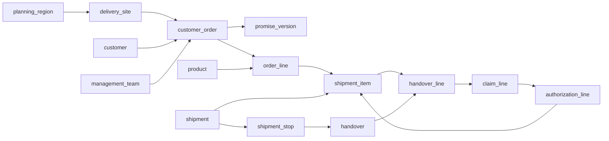

# Swedish Delivery Risk Database Knowledge

This document describes the fresh SQLite schema used to support the Swedish delivery-risk Agent. It covers how source records become model inputs, how the Agent uses a prediction, and how authorized replacement work is tracked. The schema is in `schema_fresh.sql`. The synthetic inference fixture is in `inference_seed.sql`. The original four-order walkthrough uses an older schema and should not be used as the specification for this database.

## Business boundary

An order is one customer transaction for one commodity category, one delivery site, and one agreed delivery window. It can contain multiple product lines in that category and can be fulfilled by multiple planned shipments. One physical shipment can carry items from several orders and visit several sites. Each order retains its own promise, risk assessment, and assigned order management team.

The planning region comes from the delivery site. The regional planning team reviews model-ranked orders across warehouses. A representative-authorized replacement goes to the order's assigned management team immediately.

The model predicts whether **original planned delivery** will miss the customer promise. It does not predict reshipment. Once a representative authorizes reshipment, predictive scoring stops for that order. Its urgent replacement state clears when the customer accepts all approved replacement units.

## Core relationships

`shipment_stop` gives a shared truck a separate destination, stop sequence, and planned ETA for each site. `eta_update` belongs to a stop. `shipment_item` links the goods on that truck to an exact order line. A replacement shipment item references its `authorization_line`.

## Sources of model inputs

The database stores source facts before producing `order_snapshot`. Staff or the retailer supply internal facts. API collectors supply external observations. The snapshot freezes the derived model row at an explicit `as_of_utc`.

| Model input | Source and derivation |
|---|---|
| `hours_to_deadline` | Difference between `as_of_utc` and the visible `promise_version.window_end_utc`, in hours. |
| `item_count` | Number of `order_line` rows. |
| `item_quantity` | Sum of `order_line.ordered_qty`. |
| `weight_kg`, `volume_m3` | Sum of line quantity multiplied by the product's unit measurements. Return unknown if a required measurement is absent. |
| `special_handling` | 1 if any ordered product requires it, otherwise 0. |
| `customer_type` | `customer.customer_type` through `customer_order`. |
| `stock_status` | Latest visible `stock_event` per line. For the order, the worst status wins: backorder, short, then in stock. Unknown if any line has no visible status. |
| `warehouse_stage` | Latest visible `warehouse_event` for each outstanding original shipment. The least advanced stage represents the order. |
| `actual_departure_delay_minutes` | Actual departure event time minus `shipment.planned_departure_at_utc`. Unknown until departure is recorded for the relevant original shipments. |
| `eta_delay_minutes` | Latest expected completion of the outstanding original shipments minus the latest planned completion. Unknown until an applicable ETA update is visible. |
| `warehouse`, `carrier` | Names from the original outstanding shipments. The current feature builder returns unknown if those shipments have multiple distinct values. |
| `region` | `planning_region.name` through the order's delivery site. |
| `travel_hours` | `travel_observation.travel_seconds / 3600` for the outstanding original shipment with the latest planned stop ETA. |
| `holiday_flag` | Latest visible `holiday_observation` for the region and the promise end's local date, if still fresh under the feature builder's seven-day rule. |
| `weather_severity` | Derived from a fresh, validated `weather_observation` for the site's promised delivery hour using the versioned `demo-weather-v1` precipitation and gust thresholds. Unknown when no suitable observation exists. This demo mapping has not been calibrated to the saved model's synthetic training labels. |

The saved LightGBM pipeline expects exactly these 17 features, in the order defined by `src/backend/features.py`. `src/backend/predictor.py` checks feature names and types, then returns `p_late`. A missing value is represented as `None` in Python and `NULL` in SQLite. The model pipeline imputes missing values according to its saved preprocessing steps.

The snapshot also stores the promise version, deadline, calculation time, and feature schema version. `risk_score` references that snapshot and stores the model version and probability. `original_late` belongs in `original_delivery_outcome` after the original delivery outcome is known. Train, validation, and test membership belongs in `training_assignment`, with all snapshots of one order assigned to the same split.

## Evidence timing and replay

Every scoring run receives a decision time. A warehouse or stock event may be used only when both its occurrence and recording times are no later than that decision time. An ETA update follows the same rule. An API observation may be used only after `fetched_at_utc`. A forecast additionally has a `valid_at_utc` describing the future period it covers. Promise selection uses both `recorded_at_utc` and `effective_at_utc`.

Order-level ETA and warehouse features consider **outstanding original shipments**. Handover records identify which original allocations have already been accepted. Replacement shipments are excluded from model features. A planned second installment is part of normal delivery and does not cause a reshipment override.

The current schema does not version product measurements, shipment assignment, or planned shipment times. Historical replay therefore requires fixtures establishing that those values were already known at the decision time. A future version should record when these mutable inputs become effective and visible.

## External API observations

`weather_observation` stores provider, forecast run time, valid time, fetch time, and raw wind, precipitation, and thunderstorm fields for a site. `travel_observation` stores provider, requested departure, fetched time, and travel seconds for a shipment stop. `holiday_observation` stores provider, region, local date, holiday flag, and fetched time. Collectors should preserve source identity and time rather than replacing the latest row.

The feature builder reads travel and holiday observations and classifies fresh weather observations into the model's `weather_severity` input. The weather thresholds are for the mock deployment workflow; the saved model was trained with synthetic weather categories that were not generated from those thresholds. Retrain and validate the model with consistently classified historical weather before treating its weather effect as calibrated. An unavailable or stale external observation remains unknown rather than being guessed.

## Delivery, claims, and replacement

At each handover, `handover_line` records accepted, damaged, and missing quantities for an exact shipment item. A discrepancy opens a `claim` for one order. The report itself does not authorize another trip or change the order to replacement High risk.

A representative records an `inspection`. Approved quantities are recorded in `authorization_line`. Approval must atomically create an urgent `redelivery_task` for the order's assigned management team and stop future predictive scoring. A replacement shipment item references the authorization line and has its own customer-agreed `replacement_promise`. Its ETA can change through the same stop-level `eta_update` process.

Approved quantity minus accepted replacement quantity gives the outstanding replacement balance. The rule-driven High-risk override remains active while that balance is positive. It clears when all approved units have been accepted. Model scoring stays stopped after the override clears.

Preserve three outcomes separately. **Original delivery completion** evaluates the model's pre-authorization predictions. **Full acceptable customer-order completion** measures the original customer promise. **Replacement completion** measures the agreed replacement window. If the original completion cannot be independently established, the model label is unknown.

The schema provides keys and checks for many individual rows. Application transactions or additional database triggers still need to enforce cumulative quantity ceilings, consistent handover site and shipment item, claim ownership, authorization ownership and quantity, and retry-safe task creation.

## Planner workflow

Eligible open orders are rescored after meaningful events and on a schedule near their promise end. A probability below 0.20 is Low, from 0.20 through 0.50 is Medium, and above 0.50 is High. A High model score leads the Agent to retrieve evidence and recommend a permitted action for regional planner review. The Agent does not authorize reshipment.

At the start of a shift, `shift_list` records the planning region and review capacity K. `shift_candidate` freezes distinct orders, their exact `risk_score` IDs, ranks, and selection status. Later scores can update a live worklist while preserving the shift-start ranking for Precision@K and Recall@K.

Risk episodes, recommendations, playbooks, alerts, acknowledgments, and scheduler state are not yet tables in `schema_fresh.sql`. They are subsequent implementation work.

## Current runnable inference fixture

`inference_seed.sql` inserts three synthetic open orders into a new database created from `schema_fresh.sql`. At decision time `2026-11-06T12:00:00Z`, order 1001 is in stock and packed, order 1002 is short with a two-hour ETA delay, and order 1003 has a backordered line and two outstanding original shipments. The seed contains no scores or delivery outcomes.

`run_inference_demo.py` builds the 17 features and invokes the saved LightGBM pipeline. It prints probabilities and does not persist snapshots or scores. A test against a fresh database produced approximately 57.6%, 65.1%, and 94.5% for orders 1001, 1002, and 1003. These are model outputs on synthetic examples, not measured performance on real deliveries.
