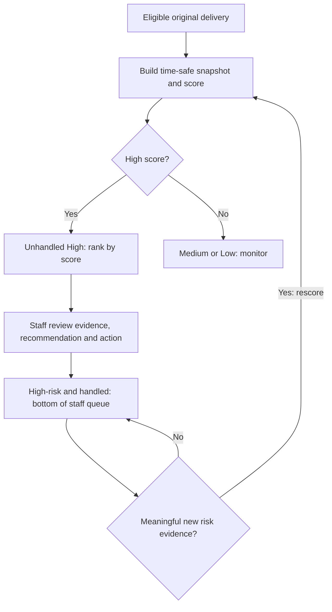

# System context and workflow notes

The companion `system_context.mmd` shows the system boundary and its essential external interactions. The rules below explain the staff queue and redelivery states without crowding the diagram.

| Step | Intended workflow |
|---|---|
| 1 | Retailer or order staff provide orders, customer promises, delivery sites, and each order’s assigned management team. Warehouse and carrier staff provide stock, shipment, ETA, and handover events. |
| 2 | Weather, travel, and holiday collectors add timestamped observations. Missing or stale observations remain unknown. |
| 3 | For an **eligible open original delivery**, the Agent builds a time-safe snapshot and runs the saved LightGBM model. Meaningful new events or a schedule can trigger another check. |
| 4 | The score becomes Low, Medium, or High. Unhandled High-risk orders go to the top of the live staff queue, sorted by descending risk probability. A High score triggers current-evidence review, a permitted-action recommendation, and an alert for the regional planner. Other scores continue to be monitored. |
| 5 | Staff review the order details, current evidence, and Agent recommendation, then decide what action to take using their professional judgment. Completing that review marks the order **High-risk and handled**. Its score remains recorded, but the order moves to the lowest-priority queue. Handling does not mean the delivery risk has disappeared. |
| 6 | If meaningful new risk evidence arrives for an eligible handled order, the system builds a new time-safe snapshot and recalculates its score. A new High-risk concern clears the handled state and returns the order to the unhandled High queue at the position set by its new score. If its new band is Medium or Low, it follows that band's normal monitoring priority. A routine refresh with no new risk should not repeatedly reopen the same handled episode. |
| 7 | Independently, a handover discrepancy opens an order claim. The representative inspects it and may approve specific replacement quantities. **A claim alone does not authorize replacement.** |
| 8 | Approval creates an urgent task for the **same order's assigned management team** and stops predictive scoring for that order. The Agent does not make the approval decision. Approval does **not** automatically mark the order **High-risk and handled**; that label records a staff review of a model-ranked risk episode. |
| 9 | While approved replacement units remain unaccepted, a **rule-driven High-risk override** applies to the urgent replacement path. It is separate from the model score and staff queue. A delayed ETA or handover discrepancy flags **Redelivery issue needs attention** for the assigned management team; accepted quantities reduce the outstanding balance. Once all approved units are accepted, the override clears and redelivery is complete. Predictive scoring does not resume. |

## Staff queue rules

| Priority | Queue state | Ordering and staff action |
|---|---|---|
| 1 | Unhandled High risk (`p_late > 0.50`) | Sort by latest `p_late` descending; staff review the order, evidence, and recommendation. |
| 2 | Medium risk (`0.20 <= p_late <= 0.50`) | Continue monitoring and review according to normal planning capacity. |
| 3 | Low risk (`p_late < 0.20`) | Continue monitoring. |
| 4 | High-risk and handled | Keep the recorded score and review outcome visible, but place the order at the bottom until new risk evidence reopens it. |

The handled state belongs to a particular risk episode or reviewed score, not permanently to the order. The current schema has no persisted risk episode, recommendation, alert, or staff acknowledgment records; those need implementation before this queue behavior can run. Authorized replacement orders do not return to predictive scoring, even when their urgent override later clears.

### Model-risk review transitions

The handled marker refers to the reviewed score and evidence. A new High-risk concern opens a new unhandled review episode; a new Medium or Low score follows its normal band. A routine refresh with no new concern leaves the earlier episode handled.

## Risk and handling states are separate

| Situation | Risk displayed | Staff-handled state | Predictive scoring |
|---|---|---|---|
| Model flags an open original delivery | Model-derived High if `p_late > 0.50` | Unhandled until staff complete a review | Continues while eligible |
| Staff complete review of that High-risk episode | Model-derived High remains recorded | High-risk and handled; lowest staff-queue priority | Continues while eligible |
| Representative authorizes redelivery | Rule-driven urgent High while approved units remain unaccepted | Not automatically marked handled; any earlier review remains historical | Stops for this order |
| All approved replacement units are accepted | Urgent High override clears | Independent of replacement completion | Remains stopped |

"Processed" can mean that an authorization transaction created the urgent task, or that staff completed a risk review. Only the second meaning sets **High-risk and handled**. The urgent replacement task remains immediate for the assigned management team regardless of an earlier handled review.

## Redelivery status and issues

Redelivery is **a separate workflow for the same customer order**, not a new `customer_order`. The original order keeps its ID, customer, site, and assigned management team. Its authorization lines define approved replacement quantities; replacement shipment items refer back to those authorizations and use a separate customer-agreed replacement promise. The urgent task and any redelivery worklist card should link to that same order ID. The earlier model scores remain historical records of the original delivery.

| Delivery phase | Condition | Risk and action |
|---|---|---|
| Redelivery authorized | Representative approves replacement quantities and the urgent task is created for the order's assigned team. | Stop original-delivery scoring. Show urgent rule-driven High while approved units remain outstanding. Do not mark staff review handled automatically. |
| In progress | An authorized replacement shipment is planned or moving under a customer-agreed replacement promise. | Keep the urgent task active and track stop-level ETA updates. |
| Partially accepted | Some approved units were accepted at handover; others remain outstanding. | Reduce the balance by accepted units. Keep urgent High while the balance is positive. |
| Completed | All approved replacement units were accepted. | Clear the urgent High override. Do not restart original-delivery scoring. |

**Redelivery issue needs attention** is an additional flag, not a new model score or a replacement for the delivery phase. Set it when a revised ETA threatens the agreed replacement window or a redelivery handover records missing or damaged units. Keep the urgent task visible to the assigned team, record the actual accepted quantities, and retain the High override while approved units remain outstanding. Further replacement quantities require inspection and authorization; do not silently add them to an existing approval. Clear the issue flag only after the specific issue is resolved. This issue flag and its escalation behavior are proposed MVP application logic; the current schema does not persist them.
